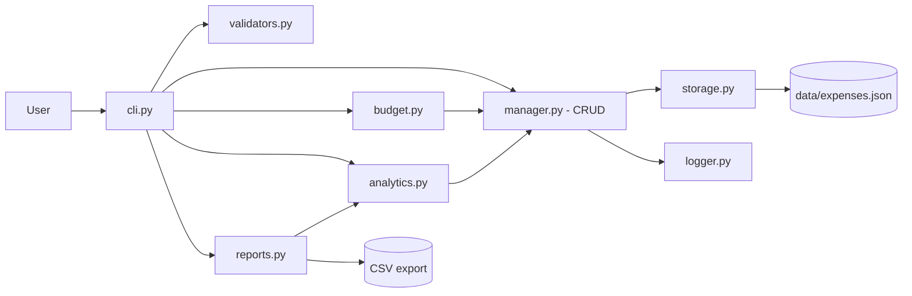
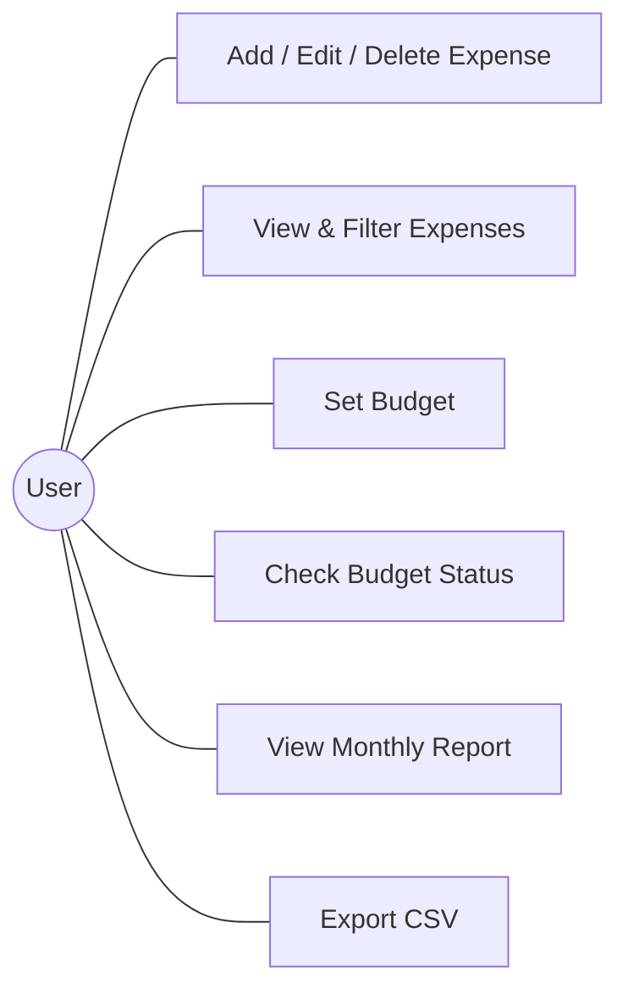
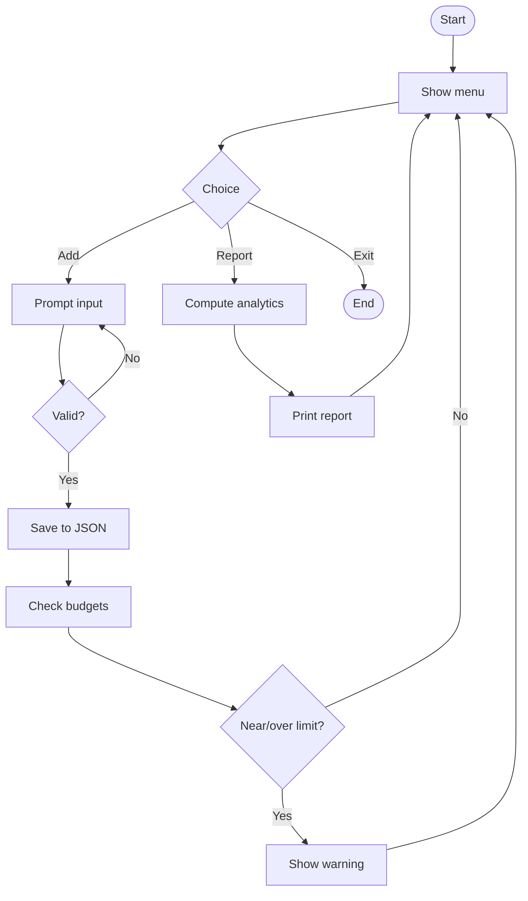
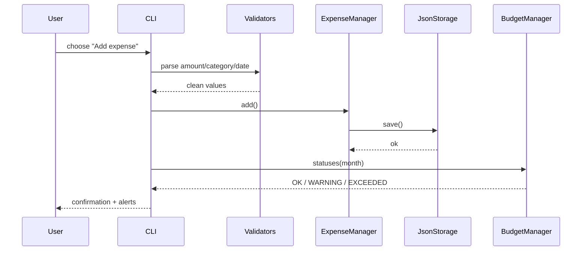
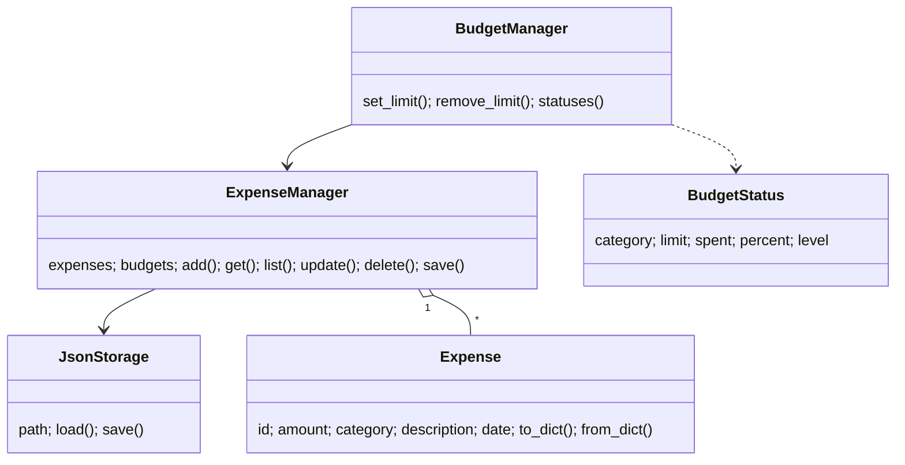

# Design Diagrams (Mermaid - paste into https://mermaid.live to export PNG for the report)

## System Architecture


## Use Case


## Workflow


## Sequence (Add Expense)


## Class Diagram


## Storage Schema (JSON - replaces ER diagram)
```
{ "expenses": [ {id, amount, category, description, date} ],
  "budgets":  { "<Category|Overall>": limit } }
```
